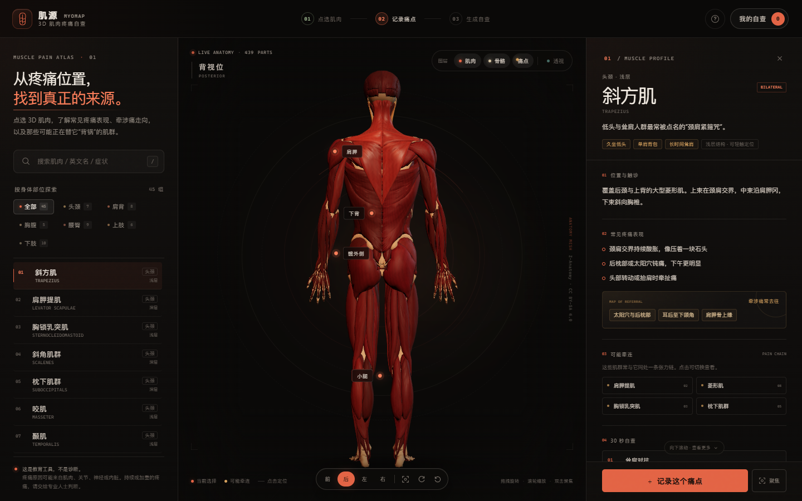
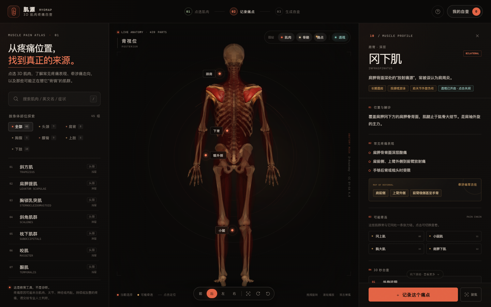
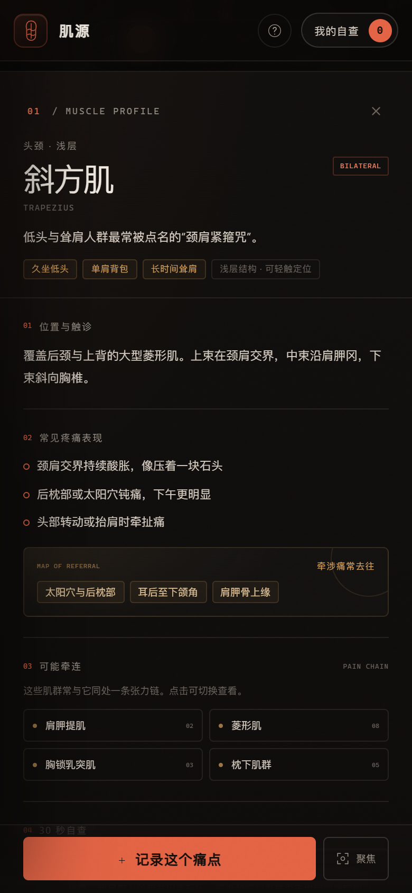

# 肌源 MyoMap · 3D 肌肉疼痛自查

一张可以点选真实人体解剖模型的疼痛自查地图：点肌肉，查看它常见的疼痛表现、牵涉痛走向、可能牵连的肌群与 30 秒自查动作；把最困扰你的几个痛点记录下来，生成一页可打印的自查小结。

> 这是一个健康教育与自我观察工具，不是诊断工具，也不能替代医生的体格检查、影像或治疗。



<details>
<summary>查看深层肌肉透视与手机端截图</summary>





</details>

## 为什么值得一看

- **真正可交互的 3D 解剖模型**，不是用几何体拼出来的人形或一张 SVG 示意图。模型包含 439 个肌肉网格和 269 个骨骼结构，每块肌肉都能单独被点选、悬停与高亮。
- **肌肉线条、肌纤维和骨骼结构**都保留了；低模感通过自定义 PBR 材质、顶点色与程序化肌纤维纹理减轻。
- **透视（X-ray）**：冈下肌、肩胛下肌、髂腰肌等深层肌肉经常被表层肌肉遮住。开启透视后，非选中肌肉变淡、骨骼半透明，深层结构会直接显形。
- **不是只有一张漂亮图**：从“点选肌肉 → 记录痛点 → 红旗筛查 → 生成小结 → 打印/PDF”的完整自查链路都可以使用。
- **45 组常见疼痛相关肌群**，覆盖头颈、肩背、胸腹、腰臀、上肢和下肢。每条资料包含位置与触诊、常见表现、牵涉区域、相关肌群、自查动作、处理建议和需要留意的警示信号。
- 记录只保存在本机 `localStorage`；没有账号、没有后端、没有上传。
- 离线可运行：three.js、DRACO 解码器和解剖网格全部在本地，不依赖 CDN。

## 快速开始

### Windows（推荐）

双击 **`start.bat`**。它会启动本地服务并自动打开浏览器。

需要安装 Python 3。如果提示找不到 Python，可从 [python.org](https://www.python.org/downloads/) 安装，安装时勾选「Add python.exe to PATH」。

### macOS / Linux / 手动运行

```bash
cd myomap
python3 server.py
```

或者用任意静态文件服务器：

```bash
python -m http.server 4173
# 打开 http://127.0.0.1:4173/
```

> **不要直接双击 `index.html`。** 浏览器会阻止 ES modules 与 `body.glb` 的本地文件读取。页面内置了针对 `file://` 的提示，但请用上面的服务器方式打开。

推荐浏览器：最新版 Chrome / Edge / Safari / Firefox，并启用硬件加速。

## 操作方式

| 操作 | 效果 |
| --- | --- |
| 拖拽 | 旋转模型 |
| 滚轮 / 双指 | 缩放 |
| 单击肌肉 | 选中并打开资料面板 |
| 悬停肌肉 | 显示肌肉名 |
| 双击肌肉 | 选中并聚焦 |
| 双击空白处 / 重置按钮 | 回到全身视图 |
| 前 / 后 / 左 / 右 | 切换解剖视角 |
| 图层「肌肉 / 骨骼」 | 独立显示或隐藏 |
| 图层「痛点」 | 显示 / 隐藏 8 个常见痛点入口 |
| 图层「透视」或 `X` 键 | 非选中肌肉淡化，查看深层结构 |
| `/` | 快速聚焦搜索框 |
| `Esc` | 关闭弹窗 / 肌群索引 |

在身体某一侧点击后，「记录痛点」会默认使用该侧（身体自身的左/右侧，而非屏幕左右）。

## 自查流程

1. **定位**：在模型上点选疼痛位置附近的肌肉，或者从左侧的肌群索引开始。模型上的「颈肩」「肩胛」「下背」等标记是常见入口，不代表你只能从这些地方开始。
2. **对照**：查看「常见疼痛表现」和「牵涉痛常去往」。很多肌肉会把疼痛投射到离它较远的地方。
3. **记录**：点击「记录这个痛点」，选择侧别、0–10 强度、疼痛类型、持续时间和加重动作。最多记录 8 个痛点。
4. **筛查**：打开右上角「我的自查」，逐项查看红旗信号。这里不是为了吓人，而是为了不漏掉需要优先就医的情况。
5. **生成**：生成自查小结，可打印或保存为 PDF，带着它去和医生、康复师沟通。

### 我应该在什么时候直接就医？

应用内包含 6 类红旗筛查。尤其是以下情况，请不要只靠拉伸或按压：

- 近期严重外伤、不能负重或明显变形；
- 进行性麻木、无力，或大小便控制异常；
- 疼痛伴发热、寒战、不明原因消瘦或夜间静息痛；
- 胸痛伴气短、冷汗、恶心，或向左臂/下颌放射；
- 单侧小腿或手臂肿胀、发热、发红；
- 疼痛持续超过 2 周并进行性加重，影响睡眠或日常活动。

## 内容与医学边界

- 资料是为大众自我观察编写的教育性整理，参考常见的肌肉骨骼评估与肌筋膜牵涉痛思路，并做了简化。不同个体的牵涉痛模式会有差异。
- 自查动作用于观察，不用于诊断；动作中如果出现麻木、锐痛、无力或头晕，请停止。
- 我们不建议对颈前（颈动脉附近）、腋窝、腹部深处等区域做强力按压。
- 「相关肌肉」表达的是同处一条张力链、常一起出现的观察方向，不代表它们一定有问题。
- 如果你在症状出现前有明确外伤、手术、肿瘤、感染或神经系统病史，请优先咨询专业人员。

## 目录结构

```text
myomap/
├── index.html                 # 页面结构
├── css/styles.css             # 视觉系统、布局、动效、打印样式
├── js/
│   ├── app.js                 # UI 状态、记录、报告、事件
│   ├── scene.js               # Three.js 场景、模型、材质、点选与透视
│   ├── data.js                # 45 组肌肉资料 + 红旗筛查
│   └── report.js              # 自查小结生成逻辑
├── assets/body.glb            # Z-Anatomy / hpfrei 的浏览器优化模型
├── libs/                      # three.js r160、GLTF/DRACO/Orbit 加载器
├── server.py                  # 零依赖本地服务器
├── start.bat / start.sh       # 一键启动
├── preview.png                # 界面预览
├── THIRD_PARTY.md             # 第三方组件和素材说明
├── LICENSE                    # CC BY-SA 4.0
└── README.md
```

## 技术实现

- **渲染**：three.js r160，WebGL 2；ACES filmic tone mapping，自定义 PBR 材质，程序化肌纤维着色器，顶点色肌群差异，Fresnel 轮廓阴影。为了避免解剖小网格上的阴影瑕疵，不使用阴影贴图；用材质和灯光塑造体积。
- **模型加载**：GLTFLoader + DRACOLoader；8.2 MB GLB，本地加载。
- **交互**：OrbitControls + raycaster；hover 与 group 高亮；相机补间；视角朝向标签；透视材质切换。
- **数据**：45 条手工整理的数据条目，映射到 80 个模型网格组名称；每条包含 symptoms、referral、related、tests、care、warning 等字段。
- **报告**：纯前端生成，不调用 AI 或外部 API，因此结果可复现、可离线；根据所选肌群、强度与红旗选项生成建议和风险提示。
- **打印**：独立的 A4 打印 CSS，打印时会隐藏应用界面，只输出报告内容。使用浏览器「打印 → 另存为 PDF」。
- **兼容**：桌面三栏布局；≤1080 px 切换到「全宽 3D + 下方详情 + 抽屉式肌群索引」；手机上详情面板的底部操作条固定在视口。

## 开发与扩展

### 增加/替换肌肉资料

编辑 `js/data.js` 中的数组。一个条目的核心字段：

```js
{
  id: 'my-muscle',
  zh: '中文名',
  en: 'English Name',
  cat: 'neck',              // neck / shoulder / torso / lowback / arm / leg
  layer: '深层',
  view: 'back',
  modelNames: ['Raw Name In GLB'],
  locus, summary, triggers,
  pain: [], referral: [], related: [],
  tests: [{ title, desc }], care: [], warning
}
```

`modelNames` 必须与 GLB 中节点的 `extras.name` 一致，否则悬停会显示「暂未收录」，而不是错误匹配。`related` 必须引用其他存在的 `id`。

### 更换视觉模型

替换 `assets/body.glb` 时，请保留按肌肉独立分组的网格；当前场景会根据每个 mesh 的 `userData.type === 'muscle'`、`userData.name` 与 `extras` 元数据建立交互。模型需要允许再分发；请同步更新 `THIRD_PARTY.md` 和 `LICENSE`。

### 本地测试

项目没有构建步骤。用 `server.py` 启动即可；如果修改了 JS/CSS，刷新页面。服务端设置了 `Cache-Control: no-store`。

## 授权与致谢

- 解剖网格：**Z-Anatomy**（CC BY-SA 4.0），经 **hpfrei/body-anatomy-3d-viewer** 简化为浏览器版本。
- 应用代码、界面与健康资料整理：以 **CC BY-SA 4.0** 共享；详见 [LICENSE](LICENSE)。
- three.js：MIT；DRACO：Apache 2.0。完整说明见 [THIRD_PARTY.md](THIRD_PARTY.md)。

如果你要把本项目用于临床环境、商业健康产品或患者教育，请安排医学审核、可访问性审核，并确认模型和内容的授权范围。
